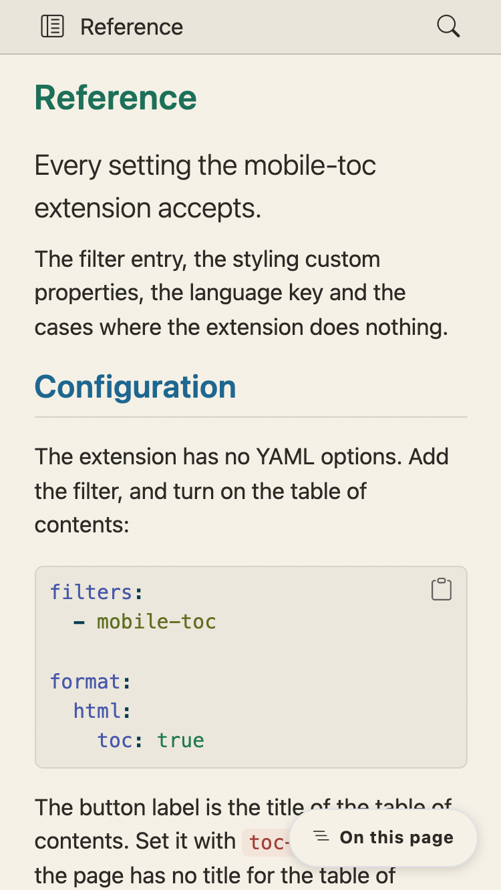
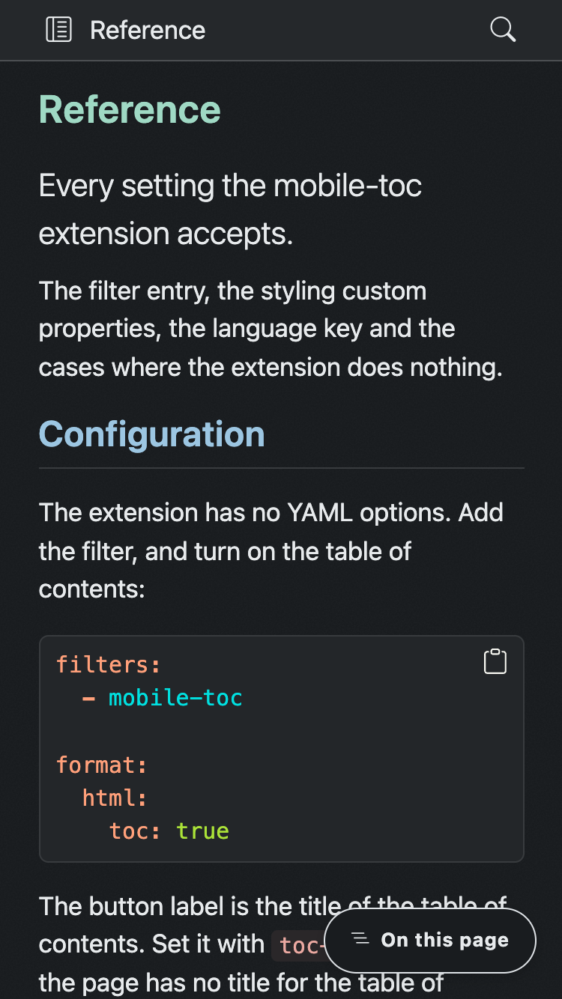
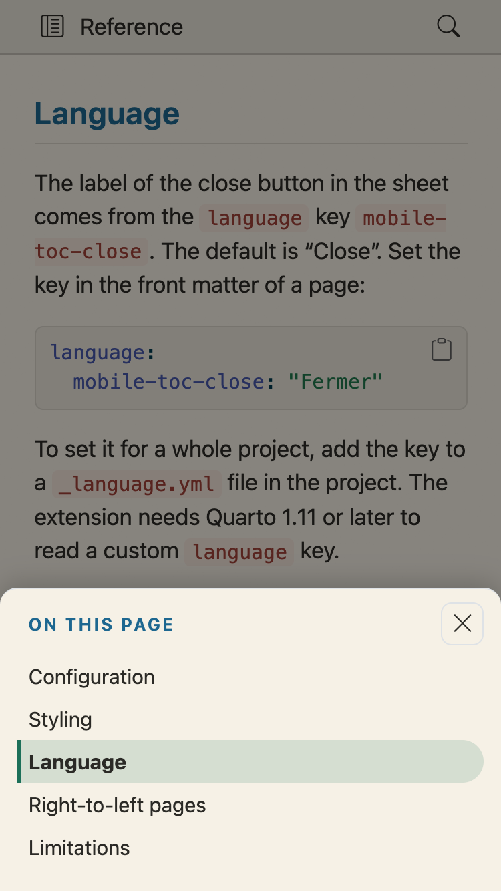
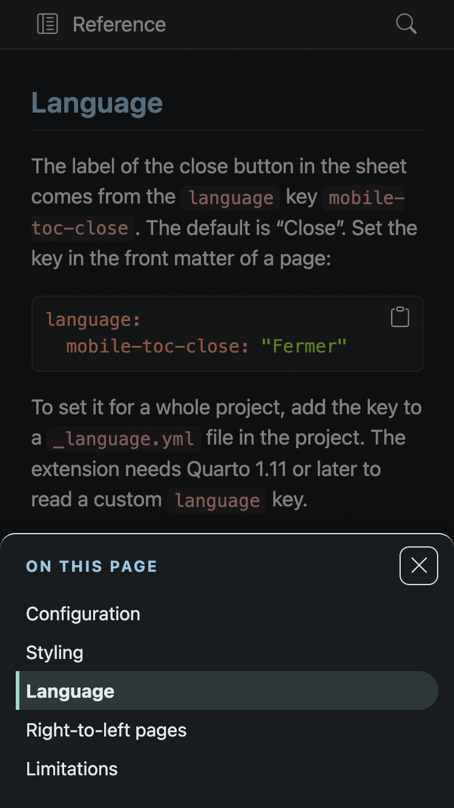

# Mobile TOC Extension For Quarto

By default, below 768 pixels, Quarto hides the table of contents and gives the reader nothing in its place.
This Quarto extension adds a button in the corner of the page that opens the table of contents in a bottom sheet.

| Button, light | Button, dark | Sheet, light | Sheet, dark |
| --- | --- | --- | --- |
|  |  |  |  |

## Installation

```bash
quarto add mcanouil/quarto-mobile-toc@0.2.1
```

This will install the extension under the `_extensions` subdirectory.

If you are using version control, you will want to check in this directory.

## Documentation

The full documentation lives at <https://m.canouil.dev/quarto-mobile-toc/>: the filter entry, the styling properties, the close label, right-to-left pages and the cases where the extension does nothing.

[`example.qmd`](example.qmd) is a short, standalone starting point you can copy.

The extension works in HTML output that uses Bootstrap, so single documents, websites and books.
In other formats, such as Reveal.js, PDF, Typst and Word, it does nothing.

## Development

Run the extension tests with `quarto pandoc lua tests/_extensions/*/extension-test/run.lua`.
CI runs only that command.
Also run `tests/_checks/projects.sh` locally, because the website and book checks do not run in CI.

## Licence

[MIT](https://github.com/mcanouil/quarto-mobile-toc?tab=MIT-1-ov-file#readme).
