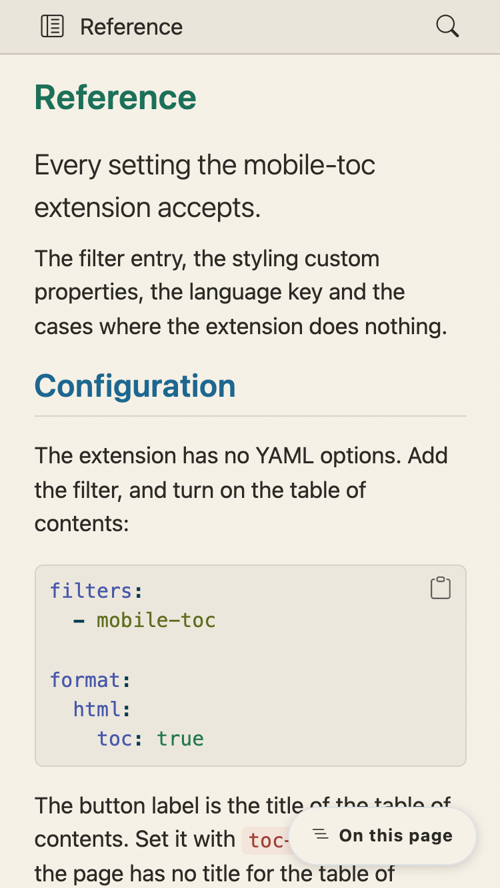
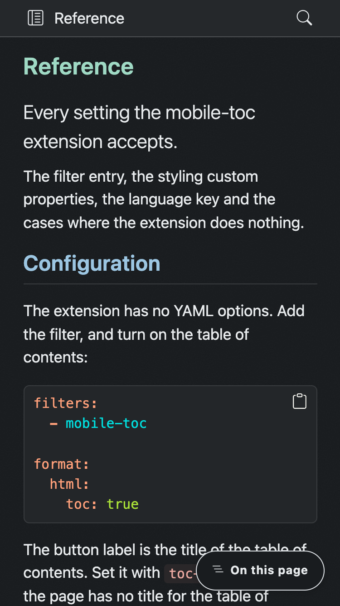
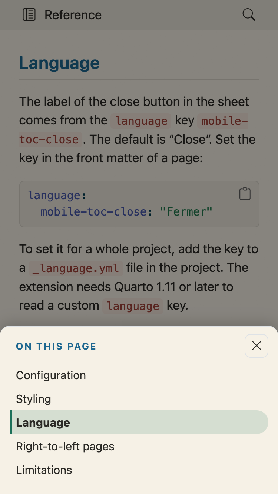
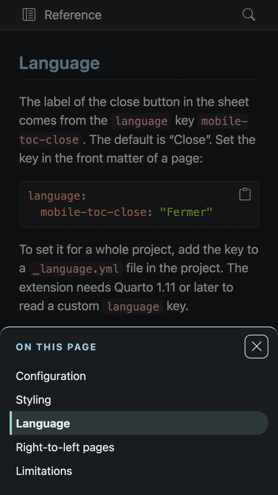

::: {.atelier-landing}

::: {.atelier-hero .gradient .glow}

::: {.atelier-hero-text}

[Quarto filter]{.atelier-eyebrow}

# Mobile TOC

[Bring the table of contents back on narrow screens, as a button and a bottom sheet.]{.atelier-lead}

::: {.atelier-actions}

[Get started](#quick-start){.btn .btn-primary .btn-lg}
[See the examples](examples.qmd){.btn .btn-outline-primary .btn-lg}

:::

::: {.panel-tabset}

## Terminal

```{.bash filename="Terminal"}
quarto add 
```

This will install the extension under the `_extensions` subdirectory.
If you are using version control, you will want to check in this directory.

## Quarto Wizard

Install it from your editor with [Quarto Wizard](https://m.canouil.dev/quarto-wizard):

::: {.btn-group role="group" aria-label="Quarto Wizard installer options"}

[Visual Studio Code](vscode://mcanouil.quarto-wizard/install?repo=){.btn .btn-outline-primary title="Install  in Visual Studio Code using the Quarto Wizard extension."}
[Positron](positron://mcanouil.quarto-wizard/install?repo=){.btn .btn-outline-primary title="Install  in Positron using the Quarto Wizard extension."}
[VSCodium](vscodium://mcanouil.quarto-wizard/install?repo=){.btn .btn-outline-primary title="Install  in VSCodium using the Quarto Wizard extension."}

:::

:::

:::

::: {.atelier-hero-figure}

[{width="320" height="312"}]{}

:::

:::

By default, below 768 pixels, Quarto hides the table of contents and shows nothing in its place.
On a phone, a reader of a long page then has no outline and no way to jump to a section.
Quarto tracks this problem as [quarto-cli#5961](https://github.com/quarto-dev/quarto-cli/issues/5961).

This extension adds a button in the bottom corner of the page.
The button opens the same table of contents in a bottom sheet.
It needs no configuration, and it takes its colours from your theme.

| Light | Dark |
| --- | --- |
| {width=240} | {width=240} |
| {width=240} | {width=240} |

: The button, and the open sheet, at 375 pixels wide. {.striped .hover}

## Quick start

Add the filter to the front matter of a page, or to `_quarto.yml` for a whole project:

```yaml
filters:
  - mobile-toc
```

Make sure that the page has a table of contents:

```yaml
format:
  html:
    toc: true
```

Open the page in a window narrower than 768 pixels, the default `md` breakpoint of the theme.
The button shows the title of the table of contents, for example "On this page".
Select the button to open the sheet.
Select a heading to close the sheet and go to that heading.

To turn the button off for one page, set `toc: false` on that page.

See the [Reference](reference.qmd) for the colours and the spacing you can change, and the [Examples](examples.qmd) for the button on a website and on a book.

## Where it works

The filter works in HTML output that uses Bootstrap, which includes single documents, websites and books.
It does nothing in other formats, such as Reveal.js, PDF, Typst and Word.
It also does nothing when the page has no table of contents, when the table of contents is in the body of the page, or when it has fewer than two links.
A browser without the Popover API shows the page as it was, with no button.

## Links

- [Reference](reference.qmd) for the styling properties and the language key.
- [Examples](examples.qmd) for the button on different pages.
- [Changelog](changelog.qmd) for what each release changed.
- [Source and issues](https://github.com/mcanouil/quarto-mobile-toc) on GitHub.

:::
